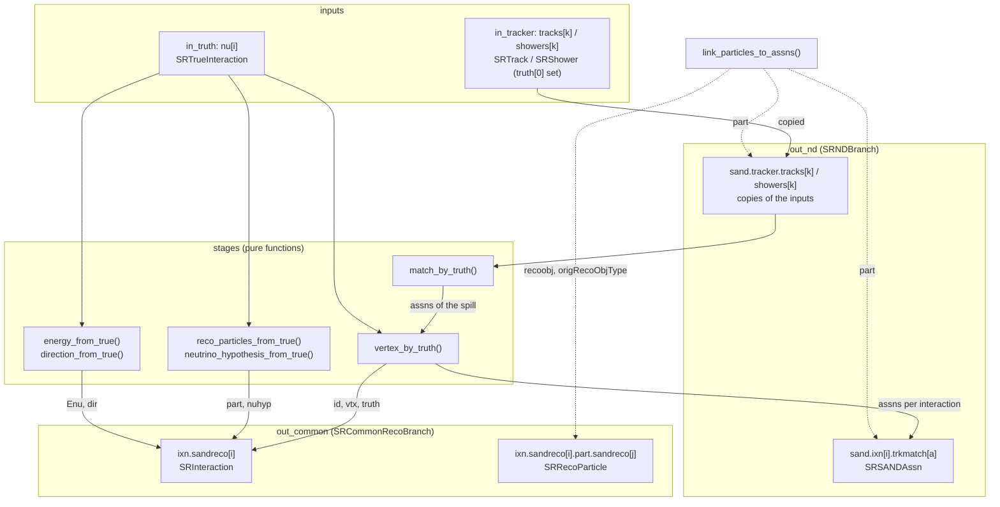

# fast_matching

Combines the truth and the objects of the subdetector reconstructions into the CAF reco branches:
`SRCommonRecoBranch` (`out_common`) and `SRNDBranch` (`out_nd`), for downstream consumers (`caf_streamer`,
`gauss_smearing`/`gluckstern_smearing`). It is the only module writing `common` and `nd`.

Today it has one subdetector input, the tracker (`in_tracker`, from `sand::tracker::fast_reco`). Every step is
"perfect": objects are grouped by their `truth[0]`, interactions, particles and estimates are copied 1:1 from the
truth, with no smearing — `gauss_smearing`/`gluckstern_smearing` perturb this output afterwards.

```json
{
  "sand::common::fast_matching": {},
  "reqs": { "in_truth": "produced_truth", "in_tracker": "produced_tracker" },
  "prods": { "out_common": "produced_common", "out_nd": "produced_nd" }
}
```

## Structure

The module is a chain of stages, one per step of a real reconstruction. Each stage is a pure function in its own
file, depends only on `duneanaobj` and returns `duneanaobj` types; `fast_matching::run()` composes them, moves
their results into the output branches and writes the cross-links between branches.

| Stage | File | Function | Input → output | A real algorithm would |
|-------|------|----------|----------------|------------------------|
| Matching | `truth_matching` | `match_by_truth` | `SRSAND` objects → `vector<SRSANDAssn>` | match objects by geometry and time |
| Vertexing | `fast_vertexing` | `vertex_by_truth` | truth + assns → `Vertices` (interactions, assns per interaction) | fit vertices, cluster assns in time |
| Particle ID | `fast_pid` | `reco_particles_from_true`, `neutrino_hypothesis_from_true` | true interaction → `SRRecoParticlesBranch`, `SRNeutrinoHypothesisBranch` | identify particles, classify the interaction |
| Kinematics | `fast_kinematics` | `energy_from_true`, `direction_from_true` | true interaction → `SRNeutrinoEnergyBranch`, `SRDirectionBranch` | estimate energy and direction |
| Links | `fast_matching.cpp` | `link_particles_to_assns` | `common` + `nd` → cross-links set | (unchanged: CAF bookkeeping) |

Only the stage functions carry the "perfect" assumptions, so a real algorithm replaces one stage with the same
output types, and each stage can later become a module of its own.

```cpp
sand.tracker = in_tracker;

auto vertices        = vertex_by_truth(truth, match_by_truth(sand));
sand.ixn             = std::move(vertices.sand);
common.ixn.sandreco  = std::move(vertices.interactions);

for (i : interactions) {
  ixn.part  = reco_particles_from_true(true_ixn, i);   // particle ID
  ixn.nuhyp = neutrino_hypothesis_from_true(true_ixn);
  ixn.Enu   = energy_from_true(true_ixn);              // kinematics
  ixn.dir   = direction_from_true(true_ixn);
}

link_particles_to_assns(truth, common, sand);
```

## Data flow


(dashed arrows: cross-reference links set by `run()`, not data copies)

---

## 1. Matching — `match_by_truth()` (`truth_matching`)

One `SRSANDAssn` per true particle that has at least one subdetector object. Three steps:

1. every object of `sand.tracker.tracks` and `sand.tracker.showers` is tagged with its `truth[0]`;
2. the tagged objects are sorted by particle (interaction, then primaries before secondaries, then position), with a
   stable sort, so that the objects of the same particle become adjacent and keep the collection order;
3. every run of adjacent objects with the same particle becomes one assn.

| `SRSANDAssn` field | Source | Notes |
|--------------------|--------|-------|
| `constituents` | `SRSANDObjID{kSANDTrackerTrack\|kSANDTrackerShower, k}` of the particle's objects | Collection order (tracks before showers), not yet beginning-to-end |
| `trk.truth` | `{truth[0]}` of the constituents | The particle of the assn; read by vertexing and links |
| `trk.truthOverlap` | `{1.0}` | |
| `trk` (other fields) | not filled | The track synthesised from the constituents is not built yet |
| `part` | set by `run()` (§5) | |

The assns are returned ordered by particle. With the tracker alone every particle has at most one object, so every
assn has one constituent.

---

## 2. Vertexing — `vertex_by_truth()` (`fast_vertexing`)

Returns `Vertices`, two index-aligned vectors: `interactions[i]` becomes `common.ixn.sandreco[i]`, `sand[i]` becomes
`nd.sand.ixn[i]`.

- one `SRInteraction` per `truth.nu[i]`, with the fields below; particles and estimates are filled by the next
  stages;
- every assn is moved into `sand[trk.truth[0].ixn].trkmatch`, keeping the order of the matching, and `ntrkmatch` is
  set. An interaction without objects has an empty `trkmatch`.

`run()` moves both vectors into the output branches and sets `nd.sand.nixn` and `common.ixn.nsandreco`.

### `caf::SRInteraction` — the reconstructed neutrino interaction

Stored in `common.ixn.sandreco[i]`, one per `truth.nu[i]`.

| Field | Type | Filled by | Source | Notes |
|-------|------|-----------|--------|-------|
| `id` | `long int` | vertexing | `true_ixn.id` | |
| `vtx` | `SRVector3D` | vertexing | `true_ixn.vtx` | Copied, no smearing |
| `truth` | `vector<size_t>` | vertexing | `{i}` | Index into `truth.nu` |
| `truthOverlap` | `vector<float>` | vertexing | `{1.0}` | Perfect reco: 100% overlap |
| `part` | `SRRecoParticlesBranch` | particle ID | `reco_particles_from_true(true_ixn, i)` | See §3 |
| `nuhyp` | `SRNeutrinoHypothesisBranch` | particle ID | `neutrino_hypothesis_from_true(true_ixn)` | See §3 |
| `Enu` | `SRNeutrinoEnergyBranch` | kinematics | `energy_from_true(true_ixn)` | See §4 |
| `dir` | `SRDirectionBranch` | kinematics | `direction_from_true(true_ixn)` | See §4 |

**Filled:** 8 fields. **Not filled** (left at default): `preselected` (`false`),
`isFromTrigger` (`true` — correct default, SAND has no cosmic-overlay concept yet).

---

## 3. Particle ID (`fast_pid`)

### `caf::SRRecoParticle` — one per primary/secondary

Stored in `common.ixn.sandreco[i].part.sandreco[j]`, **one per `true_ixn.prim`/`true_ixn.sec` entry, in that
order**, whether or not a subdetector reconstructed it. Filled by `reco_particle_from_true()` (+ `parent`/
`daughters` in `reco_particles_from_true()`, + `recoobj`/`origRecoObjType` by the links, §5).

| Field | Type | Source | Notes |
|-------|------|--------|-------|
| `primary` | `bool` | `id.type == TrueParticleID::kPrimary` | |
| `pdg` | `int` | `true_part.pdg` | |
| `score` | `float` | Hardcoded `1.0` | Perfect PID |
| `E` | `float` | `true_part.p.E` | **GeV** |
| `p` | `SRVector3D` | `{true_part.p.px, py, pz}` | **GeV/c** |
| `start` | `SRVector3D` | `true_part.start_pos` | **cm** |
| `end` | `SRVector3D` | `true_part.end_pos` | **cm** |
| `parent` | `int` | Index of the parent's `SRRecoParticle` in the same `part.sandreco`, via `true_part.parentID` | `-1` if no parent (primaries) |
| `daughters` | `vector<unsigned int>` | Reverse of `parent`: this particle's index, pushed onto its parent's `daughters` | |
| `truth` | `vector<TrueParticleID>` | `{id}` | `id = {i, kPrimary\|kSecondary, j}`, **not** `true_part.ancestor_id` |
| `truthOverlap` | `vector<float>` | `{1.0}` | |
| `recoobj` | `SRRecoBaseID` | `{i, kSANDAssn, a}` | Only for particles with an assn; unset (`kUnknown`) otherwise |
| `origRecoObjType` | `RecoObjType` | `kTrack`/`kShower`, from the type of the assn's first constituent | Set together with `recoobj` |

**Filled:** 13/17 fields. **Not filled**: `E_method`
(→ `PartEMethod::kCalorimetry` when picked up), `tgtA` (→ from `true_ixn.targetPDG`).
**Open question** (not answerable without new infrastructure): `contained`, `walldist` —
no containment query exists in the repo yet.

The one-entry-per-true-particle order is an invariant: the `parent`/`daughters` indices and the links (§5) both rely
on it.

### `caf::SRNeutrinoHypothesisBranch` / `SRCVNScoreBranch` (`SRInteraction::nuhyp.cvn`)

Filled by `neutrino_hypothesis_from_true()` — a "perfect classifier": one-hot encoding on the true class instead of a
network score.

| Field | Source |
|-------|--------|
| `isnubar` | `1` if `true_ixn.pdg < 0` else `0` |
| `nc` | `1` if `!true_ixn.iscc` else `0` |
| `nue` / `numu` / `nutau` | `1` for the flavor matching `|true_ixn.pdg|` when `iscc`, else `0` |
| `protons0`/`1`/`2`/`N` | One-hot bucket ({0,1,2,≥3}) of `true_ixn.nproton` |
| `chgpi0`/`1`/`2`/`N` | One-hot bucket of `true_ixn.npip + true_ixn.npim` |
| `pizero0`/`1`/`2`/`N` | One-hot bucket of `true_ixn.npi0` |
| `neutron0`/`1`/`2`/`N` | One-hot bucket of `true_ixn.nneutron` |

**Filled:** 21/21 fields.

---

## 4. Kinematics (`fast_kinematics`)

Every estimator collapses to the true value — a deliberate choice, not a placeholder: since this is a "perfect"
reco, every field is a copy of the truth, not a value derived bottom-up from reconstructed particles.

### `caf::SRNeutrinoEnergyBranch` (`SRInteraction::Enu`)

Filled by `energy_from_true()`.

| Field | Source |
|-------|--------|
| `calo`, `lep_calo`, `mu_range`, `mu_mcs`, `mu_mcs_llhd`, `e_calo`, `e_had`, `mu_had`, `regcnn`, `part_energy_sum` | `true_ixn.E` |

**Filled:** 10/10 fields.

### `caf::SRDirectionBranch` (`SRInteraction::dir`)

Filled by `direction_from_true()`.

| Field | Source |
|-------|--------|
| `calo`, `heshw`, `lngtrk`, `part_mom_sum` | `normalize(true_ixn.momentum)`; `(0, 0, 0)` for a null momentum |

**Filled:** 4/4 fields.

---

## 5. Subdetector objects and links

`in_tracker` is copied to `nd.sand.tracker` unchanged, except for `part`. Which particles get a tracker object and
how its fields are computed (from the tracker hits and trajectory points, threshold `min_energy_deposit`) is the
tracker's job: see `src/processes/tracker/fast_reco/README.md`.

After the stages, `link_particles_to_assns()` visits every assn `a` of every interaction `i`:

- `trk.truth[0] = {i, type, j}` gives the particle index `ipart = j` for a primary, `n_prim + j` for a secondary
  (§3 order);
- `assn.part = {i, kSandreco, ipart}`;
- for every constituent, `object.part = {i, kSandreco, ipart}`;
- `particle.recoobj = {i, kSANDAssn, a}`, `particle.origRecoObjType = kTrack|kShower` from the first constituent.

These are the only cross-branch writes of the module, and the only code that knows the CAF navigation rules.

---

## 6. Linking mechanism (four distinct ID schemes — do not confuse them)

| Link | ID type | Direction | Resolution |
|------|---------|-----------|------------|
| `SRRecoParticle::recoobj` | `SRRecoBaseID` (`{ixn, type=kSANDAssn, irecoobj}`) | Particle → assn | `sr.nd.sand.ixn[ixn].trkmatch[irecoobj]` |
| `SRSANDAssn::constituents[c]` | `SRSANDObjID` (`{type=kSANDTrackerTrack\|kSANDTrackerShower, idx}`) | Assn → object | `sr.nd.sand.tracker.tracks\|showers[idx]` — spill-level, no `ixn` |
| `SRSANDAssn::part`, `SRTrack`/`SRShower::part` | `SRRecoParticleID` (`{ixn, type=kSandreco, ipart}`) | Assn/object → particle | `sr.common.ixn.sandreco[ixn].part.sandreco[ipart]` |
| `*.truth[i]` | `TrueParticleID` (`{ixn, type=kPrimary\|kSecondary, part}`) | any reco object → truth | `truth_branch.nu[ixn].prim\|sec[part]` |

`common.ixn.sandreco` and `nd.sand.ixn` are index-aligned by construction: both come from the same `Vertices`.
In this perfect reco they are also aligned with `truth_branch.nu`; a real vertexing would express that only through
`SRInteraction::truth`/`truthOverlap`. The subdetector collections are spill-level (one `sand.tracker` for all
interactions), so `idx` counts across interactions.

---

## Not applicable (structural, not "not yet done")

`SRNDBranch::trkmatch`/`shwmatch` (`SRNDTrkAssnBranch`/`SRNDShwAssnBranch`): cross-detector
track/shower matching (ND-LAr ↔ TMS ↔ MINERvA ↔ GAr) — no SAND ID field exists in
`SRNDTrackAssn`/`SRNDShowerAssn`, nothing to populate here without a `duneanaobj` schema
change upstream. SAND's own cross-subdetector associations are `nd.sand.ixn[i].trkmatch` (§1, §2).

---

## Unit note

Subdetector objects are in **MeV**, reco particles in **GeV**, as documented upstream:
`SRTrack::E` (`///< Track energy estimate in MeV`), `SRECALCluster::E` (`[MeV]`),
`SRRecoParticle::E` (`[GeV]`). `SRTrack::Evis` and `SRShower::Evis` are not documented upstream;
they are in MeV too, like the other subdetector energies. `sand::tracker::fast_reco` takes them from edep-sim,
already in MeV; `gluckstern_smearing` starts from `SRTrueParticle::p`, in GeV, and multiplies by 1000.
