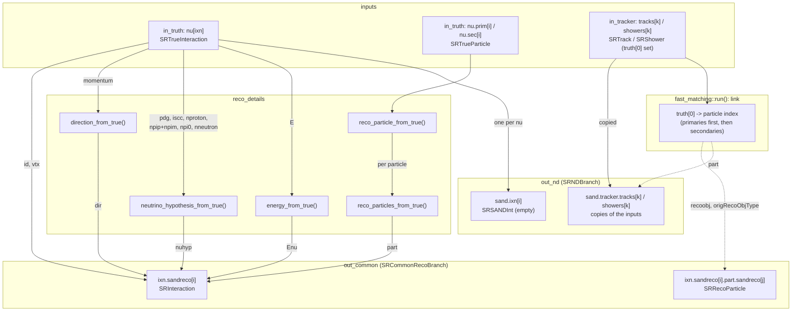

# fast_matching

Combines the truth and the objects of the subdetector reconstructions into the CAF reco branches:
`SRCommonRecoBranch` (`out_common`) and `SRNDBranch` (`out_nd`), for downstream consumers (`caf_streamer`,
`gauss_smearing`/`gluckstern_smearing`). It is the only module writing `common` and `nd`.

Today it has one subdetector input, the tracker (`in_tracker`, from `sand::tracker::fast_reco`). The matching is
"perfect": a subdetector object belongs to the particle its `truth[0]` points to. A real matching (by geometry and
time), and the GRAIN and ECAL inputs, will keep the same outputs.

The interaction and particle fields are copied 1:1 from the truth, no smearing — `gauss_smearing`/
`gluckstern_smearing` perturb this output afterwards.

```json
{
  "sand::common::fast_matching": {},
  "reqs": { "in_truth": "produced_truth", "in_tracker": "produced_tracker" },
  "prods": { "out_common": "produced_common", "out_nd": "produced_nd" }
}
```

## Data flow


(dashed arrows: cross-reference links set by the matching, not data copies)

---

## 1. `caf::SRInteraction` — the reconstructed neutrino vertex

Stored in `common_reco_branch.ixn.sandreco[i]`, one per `truth_branch.nu[i]`, filled in `fast_matching::run()`.

| Field | Type | Source | Notes |
|-------|------|--------|-------|
| `id` | `long int` | `true_ixn.id` | |
| `vtx` | `SRVector3D` | `true_ixn.vtx` | Copied, no smearing |
| `dir` | `SRDirectionBranch` | `direction_from_true(true_ixn)` | See §2 |
| `nuhyp` | `SRNeutrinoHypothesisBranch` | `neutrino_hypothesis_from_true(true_ixn)` | See §3 |
| `Enu` | `SRNeutrinoEnergyBranch` | `energy_from_true(true_ixn)` | See §4 |
| `part` | `SRRecoParticlesBranch` | `reco_particles_from_true(true_ixn, ixn_idx)` | See §5 |
| `truth` | `vector<size_t>` | `{ixn_idx}` | Index into `truth_branch.nu` |
| `truthOverlap` | `vector<float>` | `{1.0}` | Perfect reco: 100% overlap |

**Filled:** 8 fields. **Not filled** (left at default): `preselected` (`false`),
`isFromTrigger` (`true` — correct default, SAND has no cosmic-overlay concept yet).

An empty `SRSANDInt` is appended to `nd.sand.ixn` for every interaction, only to keep `common` and `nd`
index-aligned (see §7).

---

## 2. `caf::SRDirectionBranch` (`SRInteraction::dir`)

Filled by `direction_from_true()`. All four estimators collapse to the same value —
a deliberate choice, not a placeholder: since this is a "perfect" reco, every field is
a copy of the truth, not a value derived bottom-up from reconstructed particles.

| Field | Source |
|-------|--------|
| `calo` | `normalize(true_ixn.momentum)` |
| `heshw` | `normalize(true_ixn.momentum)` |
| `lngtrk` | `normalize(true_ixn.momentum)` |
| `part_mom_sum` | `normalize(true_ixn.momentum)` |

**Filled:** 4/4 fields.

---

## 3. `caf::SRNeutrinoHypothesisBranch` / `SRCVNScoreBranch` (`SRInteraction::nuhyp.cvn`)

Filled by `neutrino_hypothesis_from_true()` — a "perfect classifier": one-hot encoding
on the true class instead of a network score.

| Field | Source |
|-------|--------|
| `isnubar` | `1` if `true_ixn.pdg < 0` else `0` |
| `nc` | `1` if `!true_ixn.iscc` else `0` |
| `nue` / `numu` / `nutau` | `1` for the flavor matching `|true_ixn.pdg|` when `iscc`, else `0` |
| `protons0`/`1`/`2`/`N` | One-hot bucket ({0,1,2,≥3}) of `true_ixn.nproton` |
| `chgpi0`/`1`/`2`/`N` | One-hot bucket of `true_ixn.npip + true_ixn.npim` |
| `pizero0`/`1`/`2`/`N` | One-hot bucket of `true_ixn.npi0` |
| `neutron0`/`1`/`2`/`N` | One-hot bucket of `true_ixn.nneutron` |

**Filled:** 21/21 fields.

---

## 4. `caf::SRNeutrinoEnergyBranch` (`SRInteraction::Enu`)

Filled by `energy_from_true()`. Same "perfect reco" choice as `dir`: every estimator
collapses to `true_ixn.E`.

| Field | Source |
|-------|--------|
| `calo`, `lep_calo`, `mu_range`, `mu_mcs`, `mu_mcs_llhd`, `e_calo`, `e_had`, `mu_had`, `regcnn`, `part_energy_sum` | `true_ixn.E` |

**Filled:** 10/10 fields.

---

## 5. `caf::SRRecoParticle` — one per primary/secondary

Stored in `common_reco_branch.ixn.sandreco[i].part.sandreco[j]`, **one per `true_ixn.prim`/`true_ixn.sec` entry, in
that order**, whether or not a subdetector reconstructed it. Filled by `reco_particle_from_true()` (+ `parent`/
`daughters` in `reco_particles_from_true()`, + `recoobj`/`origRecoObjType` by the matching, §6).

| Field | Type | Source | Notes |
|-------|------|--------|-------|
| `primary` | `bool` | `id.type == TrueParticleID::kPrimary` | |
| `pdg` | `int` | `true_part.pdg` | |
| `score` | `float` | Hardcoded `1.0` | Perfect PID |
| `E` | `float` | `true_part.p.E` | **GeV** |
| `p` | `SRVector3D` | `{true_part.p.px, py, pz}` | **GeV/c** |
| `start` | `SRVector3D` | `true_part.start_pos` | **cm** |
| `end` | `SRVector3D` | `true_part.end_pos` | **cm** |
| `parent` | `int` | Index of the parent's `SRRecoParticle` in the same `part.sandreco`, via `true_part.parentID` | `-1` if no parent (primaries) |
| `daughters` | `vector<unsigned int>` | Reverse of `parent`: this particle's index, pushed onto its parent's `daughters` | |
| `truth` | `vector<TrueParticleID>` | `{id}` | `id = {ixn_idx, kPrimary\|kSecondary, i}`, **not** `true_part.ancestor_id` |
| `truthOverlap` | `vector<float>` | `{1.0}` | |
| `recoobj` | `SRRecoBaseID` | `{ixn, kSANDTrackerTrack\|kSANDTrackerShower, k}` | Only for particles with a tracker object; unset (`kUnknown`) otherwise |
| `origRecoObjType` | `RecoObjType` | `kTrack`/`kShower` | Set together with `recoobj`, never from the PDG alone |

**Filled:** 13/17 fields. **Not filled**: `E_method`
(→ `PartEMethod::kCalorimetry` when picked up), `tgtA` (→ from `true_ixn.targetPDG`).
**Open question** (not answerable without new infrastructure): `contained`, `walldist` —
no containment query exists in the repo yet.

The one-entry-per-true-particle order is an invariant: the `parent`/`daughters` indices and the matching (§6)
both rely on it.

---

## 6. Subdetector objects and matching

`in_tracker` is copied to `nd.sand.tracker` unchanged, except for `part`. Which particles get a tracker object and
how its fields are computed (from the tracker hits and trajectory points, threshold `min_energy_deposit`) is the
tracker's job: see `src/processes/tracker/fast_reco/README.md`.

The matching then links every tracker track/shower `k` to the particle built from the same true particle:

- `truth[0] = {ixn, type, i}` gives the particle index `ipart = i` for a primary, `n_prim + i` for a secondary
  (§5 order);
- `particle.recoobj = {ixn, kSANDTrackerTrack|kSANDTrackerShower, k}`, `particle.origRecoObjType = kTrack|kShower`;
- `object.part = {ixn, kSandreco, ipart}`.

In the fast reco each particle has at most one object in the tracker, so the link is one-to-one. With more
subdetectors a particle may have pieces in GRAIN, tracker and ECAL: they will be grouped in an `SRSANDAssn` in
`nd.sand.ixn[i].trkmatch`, which is still empty today.

---

## 7. Linking mechanism (three distinct ID schemes — do not confuse them)

| Link | ID type | Direction | Resolution |
|------|---------|-----------|------------|
| `SRTrack`/`SRShower::part` | `SRRecoParticleID` (`{ixn, type=kSandreco, ipart}`) | Track/Shower → Particle | `sr.common.ixn.sandreco[ixn].part.sandreco[ipart]` |
| `SRRecoParticle::recoobj` | `SRRecoBaseID` (`{ixn, type=kSANDTrackerTrack\|kSANDTrackerShower, irecoobj}`) | Particle → Track/Shower | `sr.nd.sand.tracker.tracks\|showers[irecoobj]` — spill-level, `ixn` is not used to resolve it |
| `*.truth[i]` (all three) | `TrueParticleID` (`{ixn, type=kPrimary\|kSecondary, part}`) | any reco object → truth | `truth_branch.nu[ixn].prim\|sec[part]` |

All three share the same `ixn` value across `common`/`nd` branches by construction:
`fast_matching` appends one `SRInteraction` and one `SRSANDInt` per `truth_branch.nu[i]` in
the same loop, so they stay index-aligned. The tracker collections are spill-level (one `sand.tracker` for all
interactions), so `irecoobj` counts across interactions.

---

## Not applicable (structural, not "not yet done")

`SRNDBranch::trkmatch`/`shwmatch` (`SRNDTrkAssnBranch`/`SRNDShwAssnBranch`): cross-detector
track/shower matching (ND-LAr ↔ TMS ↔ MINERvA ↔ GAr) — no SAND ID field exists in
`SRNDTrackAssn`/`SRNDShowerAssn`, nothing to populate here without a `duneanaobj` schema
change upstream.

---

## Unit note

Subdetector objects are in **MeV**, reco particles in **GeV**, as documented upstream:
`SRTrack::E` (`///< Track energy estimate in MeV`), `SRECALCluster::E` (`[MeV]`),
`SRRecoParticle::E` (`[GeV]`). `SRTrack::Evis` and `SRShower::Evis` are not documented upstream;
they are in MeV too, like the other subdetector energies. `sand::tracker::fast_reco` takes them from edep-sim,
already in MeV; `gluckstern_smearing` starts from `SRTrueParticle::p`, in GeV, and multiplies by 1000.
