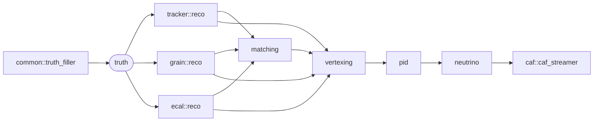

# sand::fast — the fast reconstruction chain

A truth-driven reconstruction of SAND that fills the same CAF fields a real reconstruction would. Every subdetector
builds its objects from the edep-sim hits of each true particle; matching and PID are perfect; the neutrino
hypotheses are copied from the truth. It is a stand-in to develop the analysis on, until the real algorithms exist.

## The chain

| Process | Reads | Writes | README |
|---------|-------|--------|--------|
| `sand::fast::tracker::reco` | truth, edep hits | `SRTracker`: tracks, showers | [tracker](tracker/README.md) |
| `sand::fast::grain::reco` | truth, edep hits | `SRGRAIN`: tracks, showers | [grain](grain/README.md) |
| `sand::fast::ecal::reco` | truth, edep hits | `SREcal`: clusters | [ecal](ecal/README.md) |
| `sand::fast::matching` | the three collections | `SRSANDAssn`, one per particle | [matching](matching/README.md) |
| `sand::fast::vertexing` | truth, assns, collections, geometry | `SRInteraction`, `SRSANDInt` | [vertexing](vertexing/README.md) |
| `sand::fast::pid` | truth, common, nd | `SRRecoParticle`, links | [pid](pid/README.md) |
| `sand::fast::neutrino` | truth, common | `nuhyp`, `Enu`, `dir` | [neutrino](neutrino/README.md) |

Configuration examples: `tests/framework/900_fast_reco.json` (perfect),
`901_fast_reco_gauss_smear.json` and `902_fast_reco_gluck_smear.json` (smeared afterwards). The output is checked
field by field by `sand::test::fast_reco_test` (`tests/framework/900_modules`).

Required instances: `sand::edep_reader`, `sand::genie_reader` and `sand::spill_maps` (per spill),
`sand::root_tgeomanager` and `sand::geoinfo` (global, for the target of the vertexing).

## What a fast CAF means

Read this before using the output for physics.

| Topic | What the fast chain does |
|-------|--------------------------|
| Detection | A particle is seen in a subdetector if it left hits there with at least `min_energy_deposit`. No efficiency, no resolution: smear afterwards (`gauss_smearing`, `gluckstern_smearing`). |
| Matching | Perfect: one `SRSANDAssn` per seen true particle, `truthOverlap = 1` everywhere. |
| PID | Perfect: `pdg` is the true one, `score = 1`. |
| Vertex | True vertex and time. A neutrino with nothing visible has no reco interaction. |
| Target | Material at the **true** vertex (`kOther` outside GRAIN, the tracker and the ECAL, and for the STT frames). |
| Neutrino | `nuhyp`, `Enu` and `dir` are copied from the truth (cheat), except `part_energy_sum` and `part_mom_sum`, which are sums over the visible primaries. |
| Two energies | `SRRecoParticle::E` is the true energy **at generation** [GeV]; `SRTrack::E` is the energy **at the entry** in the subdetector [MeV]. |
| Objects | Start where the particle enters the subdetector, not at the vertex. `R`, `E` and `dir` are taken at that entry point. |
| `len_cm` | Sum of the hit lengths, not the start–end distance (about 0.44 of it in the tracker). |
| Photons, π0 | Neutrals leave no hits of their own: seen only through the ECAL, or through their e±. |
| Secondaries | Visible secondaries (including delta rays) become reco particles; `parent` is the nearest **visible** ancestor, so `primary` ≠ `parent == -1`. |
| ECAL cluster | One per particle entering the ECAL. A particle crossing the ECAL twice gets one cluster at the barycenter of both crossings. |
| `assn.trk` | Only the truth is filled: use the constituents for positions, directions and energies. Constituents are in scan order (GRAIN, tracker, ECAL), not in time order. |
| Times | Absolute in the spill file. `float` fields (`vtx_time`, ECAL `time`) lose tens to hundreds of ns after the first spill. |

## Units

| Field | Unit |
|-------|------|
| positions, `len_cm`, `R`, `var_position` | cm |
| times | ns |
| `SRRecoParticle::E`, `p`; `Enu.*` | GeV |
| `SRTrack::E`, `Evis`; `SRShower::Evis`; `SRECALCluster::E` | MeV |
